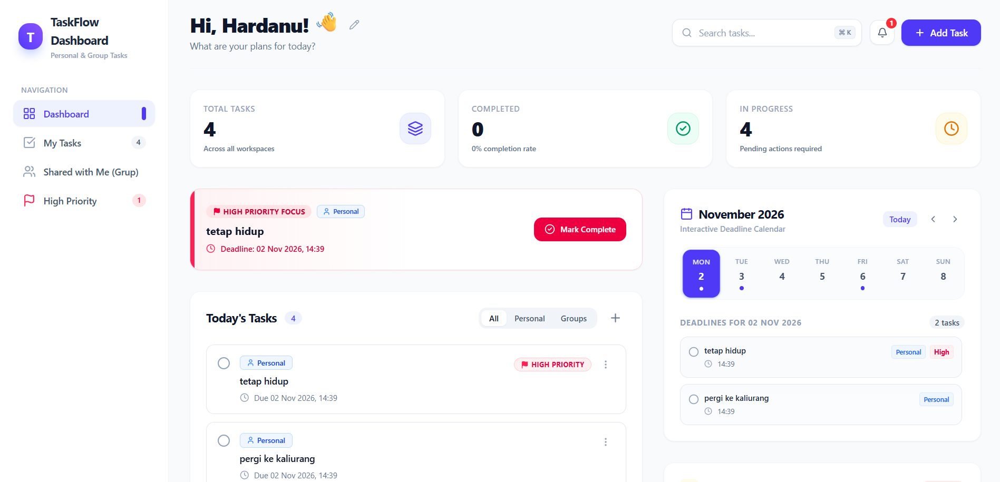
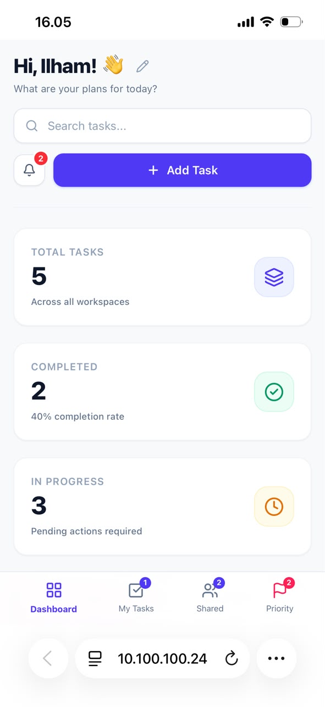

# ✨ TaskFlow Dashboard

  <h3>📸 Preview Aplikasi</h3>

| 💻 Tampilan Desktop | 📱 Tampilan Mobile |
| :---: | :---: |
|  |  |

TaskFlow adalah aplikasi manajemen tugas (To-Do List) modern yang dirancang untuk membantu Anda mengatur pekerjaan pribadi maupun kolaborasi grup dengan antarmuka yang bersih, intuitif, dan responsif.

## 🚀 Fitur Utama

- **📝 Manajemen Tugas (CRUD):** Tambah, edit, hapus, dan selesaikan tugas dengan mudah melalui modal interaktif.
- **👥 Pribadi & Grup:** Bedakan tugas untuk diri sendiri (*Personal*) atau untuk kolaborasi tim (*Group*).
- **🚩 Prioritas (Priority):** Tandai tugas penting dengan label *High Priority* (Merah), *Medium*, atau *Low* agar tidak ada yang terlewat.
- **🚨 Pengingat 6 Jam (Alerts):** Panel khusus yang secara otomatis mendeteksi dan menampilkan tugas yang *deadline*-nya kurang dari 6 jam.
- **📅 Kalender Dinamis:** Kalender interaktif yang menyorot tanggal hari ini dan menampilkan *deadline* tugas sesuai tanggal yang dipilih.
- **🔄 State Persistence:** Data tugas Anda aman dan tidak hilang saat halaman di-refresh (disimpan otomatis di `localStorage` via Zustand).
- **🎨 UI/UX Modern:** Menggunakan Tailwind CSS dengan desain *clean*, *rounded*, dan *smooth animations*.

## 🛠️ Teknologi yang Digunakan

Proyek ini dibangun menggunakan *tech stack* modern untuk memastikan performa dan skalabilitas:

- **Framework:** [React 19](https://react.dev/) + [Vite](https://vitejs.dev/)
- **Styling:** [Tailwind CSS](https://tailwindcss.com/)
- **State Management:** [Zustand](https://github.com/pmndrs/zustand) (dengan middleware `persist`)
- **Icons:** [Lucide React](https://lucide.dev/)
- **Date Handling:** [date-fns](https://date-fns.org/)
- **Linting:** ESLint

## 💻 Cara Menjalankan Proyek di Lokal

Ikuti langkah-langkah berikut untuk menjalankan proyek ini di komputer Anda:

1. **Clone repositori ini:**
   `git clone https://github.com/HardanuI/taskflow-dashboard.git`

2. **Masuk ke folder proyek:**
   `cd taskflow-dashboard`

3. **Install semua dependensi:**
   `npm install`

4. **Jalankan server pengembangan (Vite):**
   `npm run dev`

5. Buka browser Anda dan akses `http://localhost:5173`.

## 📁 Struktur Folder

- `src/` - Folder utama kode sumber
  - `components/` - Komponen UI (Sidebar, TopBar, TaskList, AlertsPanel, dll)
  - `data/` - File JSON dummy (jika masih digunakan)
  - `store/` - Zustand store untuk state management (useTaskStore.js)
  - `utils/` - Fungsi bantuan (dateUtils.js)
  - `assets/` - Gambar dan ikon statis
  - `App.jsx` - Komponen utama aplikasi
  - `main.jsx` - Entry point React
  - `index.css` - Konfigurasi Tailwind CSS

## 🗺️ Rencana Pengembangan (Future Improvements)

Proyek ini masih akan terus dikembangkan. Beberapa fitur yang direncanakan:
- [ ] Integrasi database *(Supabase / Firebase)* untuk sinkronisasi multi-device.
- [ ] Fitur *Drag and Drop* untuk mengurutkan tugas.
- [ ] Fitur *Dark Mode*.
- [ ] Notifikasi push (PWA) untuk pengingat *deadline*.
- [ ] Fitur berbagi tugas (Share Task) antar pengguna.
